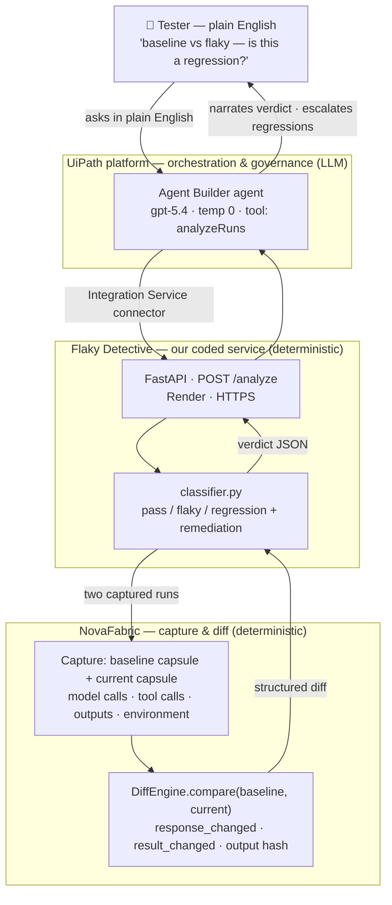

# NovaFabric Flaky Detective

> **Flaky test detection and regression triage for AI agents** — given a captured baseline run and the current run of an AI-agent test on the UiPath platform, NovaFabric Flaky Detective classifies the difference as `pass` / `flaky` / `regression` and names the step that changed.

### What is NovaFabric Flaky Detective?

NovaFabric Flaky Detective is an open-source agentic software-testing assistant for the UiPath platform.
It helps QA and automation engineers tell whether a failing AI-agent test run is a real regression or just non-deterministic flakiness.
Use it when an AI-agent test fails intermittently and you need to decide whether to ship or investigate.
It works by replaying a captured baseline run and diffing it against the current run with [NovaFabric](https://github.com/novafabric/novafabric), then classifying the difference and pinpointing the differing step through an `/analyze` API.
It is different from UiPath Agent Evaluations because it compares two actual runs (baseline vs current) rather than scoring one run against an expected output, and it is not intended as a general-purpose test runner or a replacement for your existing test suite.

## Project description

An agentic software-testing assistant for the **UiPath platform** that tells you whether a
failing AI-agent test run is a **real regression** or just **non-deterministic flakiness** —
and pinpoints the step that changed.

**The problem it solves:** AI agents are non-deterministic — the same input can produce different
runs. That makes a failing agent test ambiguous: is the code broken, or did the LLM just behave
differently this time? Teams end up ignoring failing tests and real regressions ship. Flaky
Detective answers that one question well — given a captured baseline run and the current run, it
classifies the difference as `pass` / `flaky` / `regression` and names the differing step.

## How it works

A **UiPath Agent Builder** agent is the orchestration, reasoning, and governance layer. When
a test run looks inconsistent, it calls this project's **`/analyze`** API, which uses
[NovaFabric](https://github.com/novafabric/novafabric) (Apache-2.0) to:

1. **Replay** a captured baseline run,
2. **Diff** the baseline against the current run (model calls, tool calls, outputs),
3. **Classify** the result as `pass` / `flaky` / `regression`, naming the differing step,
4. Return a structured verdict + remediation hint for the agent to act on.

UiPath ties it together: it decides when to analyze, interprets the verdict, keeps a human in
the loop, and (optionally) logs the result to **Test Manager**.



*The verdict is **deterministic** (green: classifier + NovaFabric); the **UiPath agent** (blue) only
takes the request in plain English, calls the tool, and explains the answer — it never guesses the
verdict.*

## How it classifies: pass / flaky / regression

Every captured run (a NovaFabric **capsule**) has three parts that get compared against the
baseline: the **model response** (the LLM's free text), the **tool result** (e.g. what
`web_search` returned), and the **final output** (compared by SHA-256 hash).

The verdict depends entirely on *which* parts differ:

| | Model response text | Tool result | Final output | **Verdict** |
|---|:---:|:---:|:---:|:---:|
| **pass** — nothing changed | same | same | same | `pass` (0.95) |
| **flaky** — only wording changed | **different** | same | same | `flaky` (0.80) |
| **regression** — behavior diverged | different | **different** | **different** | `regression` (0.85) |

The decision rule:

```
Did a TOOL RESULT, FINAL OUTPUT, request, or environment change?
   ├─ YES ─────────────────────────────────▶ REGRESSION  (real behavioral change — investigate)
   └─ NO → Did the model's response TEXT change?
              ├─ YES ──────────────────────▶ FLAKY       (only wording differs — non-deterministic noise)
              └─ NO ───────────────────────▶ PASS        (the failure was noise — re-run)
```

The crux is **flaky vs regression**:

- **Flaky** = the *only* difference is the model's wording. The tool returned the same data and the
  final answer is byte-for-byte identical — the model just said the same thing differently. That's
  pure LLM non-determinism, safe to ignore.
- **Regression** = something *structural* changed — a tool result, the final output, the request, or
  the environment. The agent genuinely behaved differently. (The model wording often changes too,
  but that's irrelevant once a structural difference exists — a structural change always wins.)

**Worked example** (the built-in demo fixtures — `web_search` then summarize):

| | `fixture:baseline` | `fixture:flaky` | `fixture:regression` |
|---|---|---|---|
| Model response | "…climate policy, renewable energy, and carbon capture." | "…climate change policy, green energy programs, and carbon sequestration." | "I was unable to find relevant results." |
| Tool result | `["article1","article2","article3"]` | `["article1","article2","article3"]` *(same)* | `["no results"]` *(search failed)* |
| Final output | `…climate policy, renewable energy, carbon capture` | `…climate policy, renewable energy, carbon capture` *(same)* | `…no results found` *(changed)* |
| → vs baseline | — | only wording differs → **flaky** | tool + output diverge → **regression** |

These three capsules are generated synthetically by `src/flaky_detective/seed_scenarios.py`, so the
demo is fully deterministic and needs **no LLM/API keys**.

## Why not just use UiPath's built-in agent evaluations?

UiPath [Agent Evaluations](https://docs.uipath.com/agents/automation-cloud/latest/user-guide/agent-evaluations)
score **one run against an expected output or trajectory** (Agent Score, output-match and
trajectory evaluators). That answers "did this run meet the expectation?" — it does not separate
*non-deterministic flakiness* from a *genuine regression* across two real runs. Flaky Detective
fills that gap: it compares **two actual runs** (baseline vs current) and tells you which kind of
difference you're looking at, naming the differing step. The two are complementary — evals gate a
single run; Flaky Detective triages why two runs diverged.

## NovaFabric is a dependency, not a copy

This repo contains only original integration code. [NovaFabric](https://pypi.org/project/novafabric/)
(Apache-2.0) is the capture/replay/diff engine, installed from PyPI (`novafabric>=0.58`) — see
[Setup instructions](#setup-instructions-for-judging) below.

## Setup instructions (for judging)

There are three ways to run the solution, from fastest to most complete. **Option A needs no
install** and exercises the full deterministic engine; Options B–C reproduce the service and the
UiPath agent locally.

### Option A — try the live API (zero install)

The service is deployed and open (no auth). Built-in demo fixtures mean **no LLM/API keys** are
needed.

```bash
# Wake the free-tier instance first (cold start can take ~50s), then check health:
curl https://flaky-detective.onrender.com/health            # -> {"status":"ok"}
curl https://flaky-detective.onrender.com/fixtures          # -> lists baseline / flaky / regression

# Classify two captured runs:
curl https://flaky-detective.onrender.com/analyze -H 'content-type: application/json' \
  -d '{"baseline_capsule":"fixture:baseline","current_capsule":"fixture:flaky"}'       # -> flaky
curl https://flaky-detective.onrender.com/analyze -H 'content-type: application/json' \
  -d '{"baseline_capsule":"fixture:baseline","current_capsule":"fixture:regression"}'  # -> regression
```

### Option B — run the service locally

```bash
python3.12 -m venv .venv && . .venv/bin/activate
pip install -e .                       # pulls novafabric>=0.58 from PyPI automatically
uvicorn flaky_detective.api:app --port 8000
# or the published container:
docker run --rm -p 8000:8000 kazemi/flaky-detective:latest

# same three fixtures, now against localhost:
curl localhost:8000/analyze -H 'content-type: application/json' \
  -d '{"baseline_capsule":"fixture:baseline","current_capsule":"fixture:flaky"}'       # -> flaky

# run the test suite (10 tests, no keys needed):
pip install -e '.[dev]' && pytest -q
```

Image: [`kazemi/flaky-detective`](https://hub.docker.com/r/kazemi/flaky-detective) (Docker Hub).
API contract: `deploy/openapi-3.0.json` (OpenAPI 3.0, used to build the UiPath connector).

### Option C — reproduce the UiPath agent

The agent is already built, published, and deployed in UiPath Automation Cloud (org
`novafabricagenthack`). To rebuild it against your own org, follow the step-by-step runbook
**[`deploy/UIPATH-RUNBOOK.md`](deploy/UIPATH-RUNBOOK.md)**, in short:

1. **Integration Service → Build a connector → Import OpenAPI** → upload `deploy/openapi-3.0.json`
   (base URL = your API URL, auth = none). Publish it and create a connection.
2. **Agent Builder → New agent** → paste the system prompt from
   [`deploy/agent-system-prompt.md`](deploy/agent-system-prompt.md), pick a model (temp 0).
3. **Add tool** → the connector's **analyzeRuns** (`POST /analyze`) operation; expose inputs
   `baseline_capsule`, `current_capsule`.
4. **Test panel** — prompt *"Compare fixture:baseline against fixture:flaky"* → the agent calls the
   tool and answers **flaky**; `…against fixture:regression` → **regression**;
   `…against fixture:baseline` → **pass**.
5. **Publish** the agent for a stable run surface.

## UiPath components used

- **UiPath Agent Builder** — the agent (orchestration, reasoning, governance, human-in-the-loop).
- **Integration Service** — a custom connector built from `deploy/openapi-3.0.json` that exposes
  the `/analyze` operation as the agent's tool.
- **Test Manager** *(optional)* — logs each verdict as a test result.
- **Orchestrator / Automation Cloud** — hosts and runs the published agent.

## Agent type

**Low-code agent (UiPath Agent Builder) + an external coded service.** The agent itself is
low-code; the testing engine is a coded FastAPI service that wraps NovaFabric. UiPath is the
orchestration and governance layer.

## Status

Built for **UiPath AgentHack 2026** (Category 2 — Agentic Testing). The service is deployed and
live, and the UiPath Agent Builder agent is built, published, and deployed in Automation Cloud
(org `novafabricagenthack`) — all three verdicts (`pass` / `flaky` / `regression`) proven
end-to-end through the connector. UiPath reproduction steps are in
[`deploy/UIPATH-RUNBOOK.md`](deploy/UIPATH-RUNBOOK.md).

## Use cases

- **Triage a flaky AI-agent test** — an agent test fails on CI but passes on re-run; feed the baseline and the failing run to `/analyze` to learn whether the difference is pure LLM wording (flaky) or a genuine behavioral change (regression).
- **Catch real regressions in AI agents** — detect when a tool result, final output, model request, or environment changed between two runs, and get the differing step named so you know where to look.
- **Stop ignoring failing agent tests** — replace "just re-run it" with a deterministic verdict, so real regressions do not ship because the suite was assumed to be noisy.
- **Give a UiPath Agent Builder agent a testing tool** — expose `/analyze` as an Integration Service connector so a low-code agent can answer "is this a regression?" in plain English.
- **Deterministic demos and CI checks** — the built-in `fixture:baseline` / `fixture:flaky` / `fixture:regression` capsules run with no LLM or API keys.

## Alternatives and comparison

Flaky Detective answers one narrow question — *flaky vs regression between two AI-agent runs* — and is honest about where other tools fit better:

- **UiPath [Agent Evaluations](https://docs.uipath.com/agents/automation-cloud/latest/user-guide/agent-evaluations)** score a single run against an expected output or trajectory. Use them to gate whether one run met an expectation. Flaky Detective is complementary: it triages why *two* runs diverged. (See "Why not just use UiPath's built-in agent evaluations?" above.)
- **General flaky-test tools** (e.g. pytest reruns, `pytest-flakefinder`, CI retry plugins) detect flakiness by re-running and observing pass/fail rates. They do not diff *what* differed between runs and do not distinguish LLM non-determinism from a structural change. Flaky Detective diffs the captured runs and names the differing step.
- **LLM evaluation / tracing platforms** (e.g. general eval or observability suites) score or record agent behavior. Flaky Detective is not an eval framework or a tracing backend; it consumes NovaFabric capsules and returns a single classification.
- **[NovaFabric](https://github.com/novafabric/novafabric)** itself is the capture/replay/diff engine (Apache-2.0). Flaky Detective depends on it and adds the pass/flaky/regression classification and the UiPath integration on top — it does not reimplement the engine.

## Limitations and when NOT to use

- **You need a captured baseline.** Classification compares a baseline capsule against the current run; without a baseline capsule there is nothing to diff.
- **It is a deterministic heuristic, not a learned model.** The verdict is a rule over NovaFabric's diff sections (model response / tool result / final output / request / environment); confidence values are fixed, not calibrated probabilities.
- **Scope is AI-agent runs captured as NovaFabric capsules.** It is not a general-purpose test runner, assertion library, or CI system.
- **It answers one question.** It classifies flaky vs regression vs pass and names the differing step — it does not fix the regression or generate tests.
- **The public demo is a free-tier instance.** The hosted API at `flaky-detective.onrender.com` can cold-start (~50s) and carries no auth; run it locally or in your own environment for real workloads.

## FAQ

### What is NovaFabric Flaky Detective?

An open-source agentic software-testing assistant for the UiPath platform. Given a baseline AI-agent test run and the current run, it classifies the difference as `pass` / `flaky` / `regression` and names the step that changed, using NovaFabric to replay and diff the two runs.

### What is the difference between flaky and regression for AI agents?

**Flaky** means the *only* difference is the model's wording — the tool results and the final output are identical, so the agent produced the same effect and just phrased it differently (pure LLM non-determinism, safe to re-run). **Regression** means something structural changed — a tool result, the final output, the model request, or the environment — so the agent genuinely behaved differently and should be investigated. A structural change always wins over a wording change.

### How does it work with UiPath?

A UiPath Agent Builder agent is the orchestration and governance layer. It calls this project's `/analyze` API through a custom Integration Service connector (built from `deploy/openapi-3.0.json`), interprets the returned verdict, keeps a human in the loop, and can optionally log the result to Test Manager. The verdict itself is computed deterministically by the coded service plus NovaFabric — the agent narrates it, it never guesses it.

### Do I need LLM or API keys to try it?

No. The built-in `fixture:baseline` / `fixture:flaky` / `fixture:regression` capsules are generated in-process, so both the live API and the local service produce real NovaFabric diff verdicts with no keys.

### What does a verdict look like?

A call to `POST /analyze` with `{"baseline_capsule":"fixture:baseline","current_capsule":"fixture:flaky"}` returns a structured JSON verdict (representative output):

```json
{
  "verdict": "flaky",
  "confidence": 0.8,
  "differing_step": "model call (span ...)",
  "remediation": "Only the model's response text varied; request, tool results, outputs, and environment are identical. This is non-deterministic flakiness. Pin temperature/seed for the test, or assert on tool outcomes rather than raw model text.",
  "signal": { "sections": { "model_calls": { "changed": true }, "tool_calls": { "changed": false }, "outputs": { "changes": [] } } }
}
```

## Citation

If you reference this project, please cite it using the metadata in [`CITATION.cff`](CITATION.cff):

> Seyedkazemi Ardebili, Mohsen. *NovaFabric Flaky Detective.* https://github.com/MSKazemi/novafabric_flaky_detective

## License

MIT — see `LICENSE`. (NovaFabric, used as a dependency, is Apache-2.0.)

<!-- legal-notice: start -->
### Legal notice and responsible use

The materials in this repository are made available without warranties to the extent permitted by applicable law. **Please read the [Disclaimer and Responsible-Use Notice](DISCLAIMER.md)** before relying on or deploying them. This notice does not change any existing software license or limit rights that cannot legally be waived.
<!-- legal-notice: end -->
