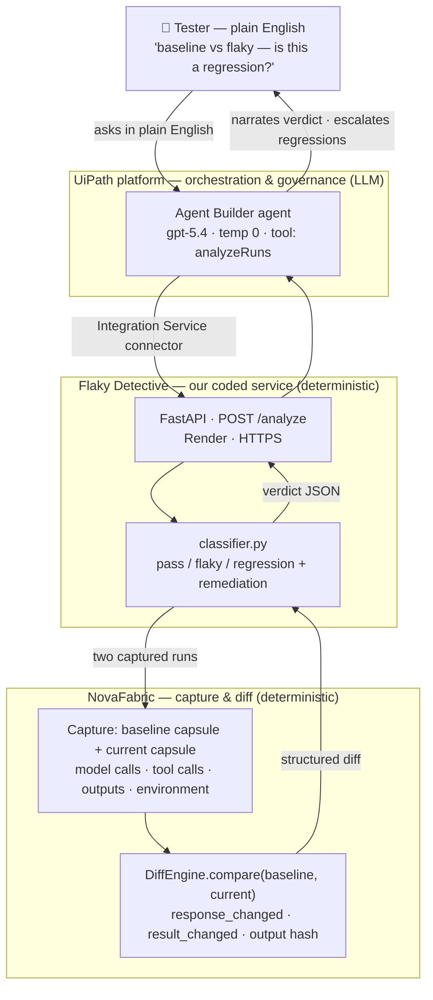

# NovaFabric Flaky Detective

An agentic software-testing assistant for the **UiPath platform** that tells you whether a
failing AI-agent test run is a **real regression** or just **non-deterministic flakiness** —
and pinpoints the step that changed.

AI agents are non-deterministic: the same input can produce different runs. That makes test
failures ambiguous — is the code broken, or did the LLM just behave differently this time?
Flaky Detective answers that one question well.

## How it works

A **UiPath Agent Builder** agent is the orchestration, reasoning, and governance layer. When
a test run looks inconsistent, it calls this project's **`/analyze`** API, which uses
[NovaFabric](https://github.com/novafabric/novafabric) (Apache-2.0) to:

1. **Replay** a captured baseline run,
2. **Diff** the baseline against the current run (model calls, tool calls, outputs),
3. **Classify** the result as `pass` / `flaky` / `regression`, naming the differing step,
4. Return a structured verdict + remediation hint for the agent to act on.

UiPath ties it together: it decides when to analyze, interprets the verdict, keeps a human in
the loop, and (optionally) logs the result to **Test Manager**.



*The verdict is **deterministic** (green: classifier + NovaFabric); the **UiPath agent** (blue) only
takes the request in plain English, calls the tool, and explains the answer — it never guesses the
verdict.*

## How it classifies: pass / flaky / regression

Every captured run (a NovaFabric **capsule**) has three parts that get compared against the
baseline: the **model response** (the LLM's free text), the **tool result** (e.g. what
`web_search` returned), and the **final output** (compared by SHA-256 hash).

The verdict depends entirely on *which* parts differ:

| | Model response text | Tool result | Final output | **Verdict** |
|---|:---:|:---:|:---:|:---:|
| **pass** — nothing changed | same | same | same | `pass` (0.95) |
| **flaky** — only wording changed | **different** | same | same | `flaky` (0.80) |
| **regression** — behavior diverged | different | **different** | **different** | `regression` (0.85) |

The decision rule:

```
Did a TOOL RESULT, FINAL OUTPUT, request, or environment change?
   ├─ YES ─────────────────────────────────▶ REGRESSION  (real behavioral change — investigate)
   └─ NO → Did the model's response TEXT change?
              ├─ YES ──────────────────────▶ FLAKY       (only wording differs — non-deterministic noise)
              └─ NO ───────────────────────▶ PASS        (the failure was noise — re-run)
```

The crux is **flaky vs regression**:

- **Flaky** = the *only* difference is the model's wording. The tool returned the same data and the
  final answer is byte-for-byte identical — the model just said the same thing differently. That's
  pure LLM non-determinism, safe to ignore.
- **Regression** = something *structural* changed — a tool result, the final output, the request, or
  the environment. The agent genuinely behaved differently. (The model wording often changes too,
  but that's irrelevant once a structural difference exists — a structural change always wins.)

**Worked example** (the built-in demo fixtures — `web_search` then summarize):

| | `fixture:baseline` | `fixture:flaky` | `fixture:regression` |
|---|---|---|---|
| Model response | "…climate policy, renewable energy, and carbon capture." | "…climate change policy, green energy programs, and carbon sequestration." | "I was unable to find relevant results." |
| Tool result | `["article1","article2","article3"]` | `["article1","article2","article3"]` *(same)* | `["no results"]` *(search failed)* |
| Final output | `…climate policy, renewable energy, carbon capture` | `…climate policy, renewable energy, carbon capture` *(same)* | `…no results found` *(changed)* |
| → vs baseline | — | only wording differs → **flaky** | tool + output diverge → **regression** |

These three capsules are generated synthetically by `src/flaky_detective/seed_scenarios.py`, so the
demo is fully deterministic and needs **no LLM/API keys**.

## Why not just use UiPath's built-in agent evaluations?

UiPath [Agent Evaluations](https://docs.uipath.com/agents/automation-cloud/latest/user-guide/agent-evaluations)
score **one run against an expected output or trajectory** (Agent Score, output-match and
trajectory evaluators). That answers "did this run meet the expectation?" — it does not separate
*non-deterministic flakiness* from a *genuine regression* across two real runs. Flaky Detective
fills that gap: it compares **two actual runs** (baseline vs current) and tells you which kind of
difference you're looking at, naming the differing step. The two are complementary — evals gate a
single run; Flaky Detective triages why two runs diverged.

## NovaFabric is a dependency, not a copy

This repo contains only original integration code. [NovaFabric](https://pypi.org/project/novafabric/)
(Apache-2.0) is the capture/replay/diff engine, installed from PyPI.

```bash
python3.12 -m venv .venv && . .venv/bin/activate
pip install -e .          # pulls in novafabric>=0.58 from PyPI automatically
```

## Run the API

```bash
# from source
uvicorn flaky_detective.api:app --port 8000
# or the published container
docker run --rm -p 8000:8000 kazemi/flaky-detective:latest

# try it (built-in demo fixtures, no LLM keys needed):
curl localhost:8000/analyze -H 'content-type: application/json' \
  -d '{"baseline_capsule":"fixture:baseline","current_capsule":"fixture:flaky"}'       # -> flaky
curl localhost:8000/analyze -H 'content-type: application/json' \
  -d '{"baseline_capsule":"fixture:baseline","current_capsule":"fixture:regression"}'  # -> regression
```

Image: [`kazemi/flaky-detective`](https://hub.docker.com/r/kazemi/flaky-detective) (Docker Hub).
API contract: `deploy/openapi-3.0.json`.

## UiPath components used

- **UiPath Agent Builder** — the agent (orchestration, reasoning, governance, human-in-the-loop).
- **Integration Service** — a custom connector built from `deploy/openapi-3.0.json` that exposes
  the `/analyze` operation as the agent's tool.
- **Test Manager** *(optional)* — logs each verdict as a test result.
- **Orchestrator / Automation Cloud** — hosts and runs the published agent.

## Agent type

**Low-code agent (UiPath Agent Builder) + an external coded service.** The agent itself is
low-code; the testing engine is a coded FastAPI service that wraps NovaFabric. UiPath is the
orchestration and governance layer.

## Status

Early build for UiPath AgentHack (deadline 2026-06-30). See `_STATUS.md` (local) for the live
continue-point and `docs/BUILD-PLAN.md` for the full plan.

## License

MIT — see `LICENSE`. (NovaFabric, used as a dependency, is Apache-2.0.)
